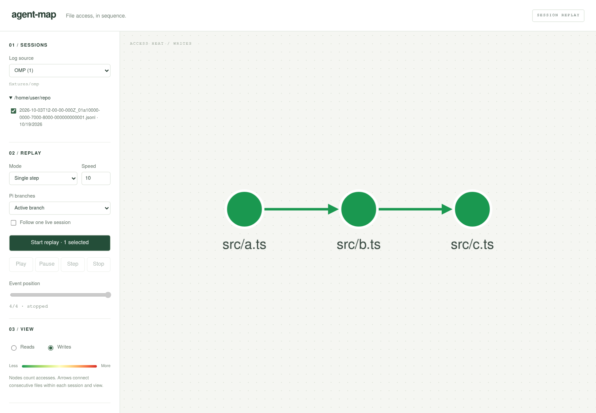

# agent-map

Bun workspace: Pi, Copilot CLI, OMP, and raw JSONL file accesses → separate reads/writes transition graphs → SSE/Cytoscape replay and deterministic Mermaid output.



## Run

```sh
bun install
bun test
bun run build:web
bun run server                 # http://localhost:3000, built UI + API
# Or run `bun run web` alongside the server for Vite at http://localhost:5173.

bun packages/cli/src/index.ts run --source pi --session <uuid-or-path> --out out
bun packages/cli/src/index.ts run --source pi --session /tmp/live.jsonl --follow --id live
# Ctrl-C writes both Mermaid views before exiting.
```

Browser viewport regression check: with `bun run web` running, open `http://localhost:5173/test/graph.html` (100 replay events, resize/view switches, snapshot resets, and a long session sidebar).

CLI flags: repeat `--session` to merge logs; `--branches active|all`; `--scale linear|log`; `--id <filename>` for stable output names. Source is `pi` (default), `copilot`, `omp`, or `trace`. Trace input is JSONL: `{"op":"read","path":"src/a.ts","ts":1700000000000,"tool":"read"}` (`ts` and `tool` optional). Newline-containing paths and non-file `scheme://` URIs are excluded for every source.

The browser's **Log source** picker shows Pi agent, Copilot CLI, and OMP session counts and the scanned directory, then groups that source's sessions by repository. Selections persist across source switches; the Start button counts all selected sessions for cross-source merges. Select sessions and Start; fixed/scaled modes play automatically, single-step mode waits for Step or Play. Pause, Step, seek, speed changes, and Stop work on the same replay. Stop/completion reveals per-view Mermaid with Copy/Download. Follow accepts one log, keeps receiving complete appended lines, and finishes on Stop.

The graph fills the space beside the session controls. Replay progress stays in the Replay section; there is no live diff panel.

## Configuration

- `PI_SESSIONS_DIR`: defaults to `~/.pi/agent/sessions`.
- `COPILOT_SESSIONS_DIR`: defaults to `~/.copilot/session-state` (nested `events.jsonl` and legacy flat JSONL).
- `OMP_SESSIONS_DIR`: defaults to `~/.omp/agent/sessions` (top-level sessions only, not nested subagent transcripts).
- `AGENT_MAP_OUT`: server output directory, default `out`.
- `PORT`: server port, default `3000`; Vite's development proxy targets port 3000.

Run the server from this repository root so `packages/web/dist` resolves. It binds to loopback: the API can read local session paths and is not an authenticated multi-user service.

Fixture-backed demo:

```sh
PI_SESSIONS_DIR=fixtures/pi COPILOT_SESSIONS_DIR=fixtures/copilot OMP_SESSIONS_DIR=fixtures/omp bun run server
bun packages/cli/src/index.ts run --source pi \
  --session fixtures/pi/--home-user-repo--/2026-10-01T10-00-00-000Z_11111111-1111-4111-8111-111111111111.jsonl \
  --out /tmp/am --id demo
```

## Semantics and limits

- Accesses count at tool-call time, including failed calls. Only mapped file tools count; shell/directory/search tools do not infer file accesses.
- Pi/OMP's active branch is root → last entry. All-branch mode replays each leaf with a separate session ID; shared prefixes count once per branch. Follow uses file order, not branch reconstruction.
- OMP accepts title-slot and legacy header-first files, strips read selectors, and counts each file header in hashline edits as a write. Metadata/tool-result records do not duplicate accesses. Discovery reads a bounded 16 KiB prefix; lazy/empty and malformed headers are skipped.
- Non-follow logs merge by epoch timestamp, session ID, then sequence. Transitions stay within each session and view; consecutive repeats increase weight without self-loops.
- Each completed/stopped replay writes `<id>.reads.mmd` and `<id>.writes.mmd`. Output depends only on the consumed event prefix, including after seek.
- Default rules: `packages/log-adaptors/rules/{pi,copilot,omp}.json`, with RFC 6901 pointers, optional tool-name prefix wildcards, and OMP hashline extraction. Copilot `view`/`edit`/`create` currently assume the argument `path`; that field is **not verified against a real Copilot log**. The Copilot fixture is synthetic, based on the documented envelope. The first Pi fixture is redacted from a real session.
- Scaled mode caps idle delays at `MAX_GAP_MS = 5000` in `replay.ts`. Follow uses `fs.watch`; reducer copies and browser recoloring are O(graph size). No directory collapsing, top-N filtering, or ELK layout.
- The graph row stays within the screen; long session lists scroll separately. Replay uses Cytoscape's [`fit()`](https://js.cytoscape.org/#cy.fit) for all nodes, edges and labels, plus [`resize()`](https://js.cytoscape.org/#cy.resize) when the container changes. Dagre grows left-to-right on wide canvases and top-to-bottom on tall ones. Layouts remain throttled to 300 ms but fit immediately on topology changes; non-animated placement prevents temporary clipping. Very large graphs zoom out without a minimum floor, trading label size for keeping the entire graph visible.

## API

- `GET /api/sources` — discoverable source labels and configured directories, in picker order (Pi, Copilot CLI, OMP; no path-only trace source).
- `GET /api/sessions?source=pi|copilot|omp&repo=…`
- `POST /api/replays` with `{sessionIds:["pi:<uuid>","trace:<path>"], mode:"fixed"|"scaled"|"step", speed:10, branches:"active"|"all", follow:false}`.
- `GET /api/replays/:id` — snapshot.
- `GET /api/replays/:id/events` — SSE `snapshot`, `diff`, `progress`, `done`, heartbeat `ping`.
- `POST /api/replays/:id/control` with `{action:"play"|"pause"|"step"|"seek"|"stop", speed?, to?}`.
- `GET /api/replays/:id/mermaid?view=reads|writes` — available only after stop/completion.

`@agent-map/core` is browser-safe and owns graph/wire types. `@agent-map/log-adaptors` owns the parser registry, format rules, discovery, file streaming, and session merge helpers used by both server and CLI. Pi packages are development-only type imports. Bun runs core/adaptors/server/CLI TypeScript directly; Vite builds only the web package.
